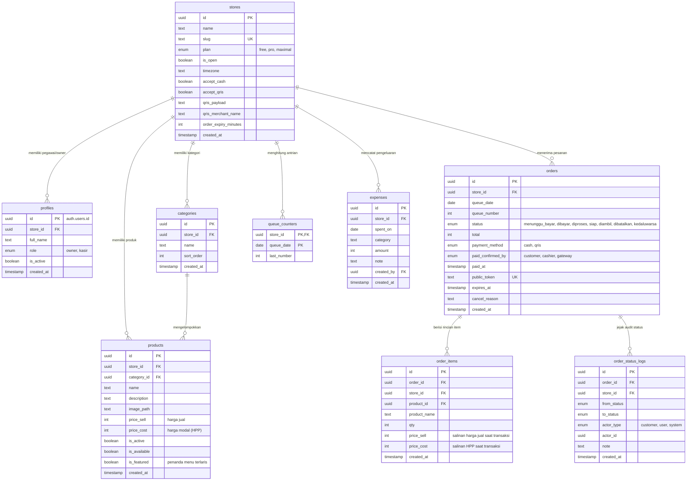

# 🍃 PayBuy — Kasir & Pemesanan Mandiri UMKM

<div align="center">


<br />
**Sistem Kasir & Pemesanan Mandiri Berbasis Web untuk UMKM Makanan dan Minuman**
<br />
*"Pesanan Rapi Tanpa Antri, Bayar Dulu, Dapur Tenang."*

[](https://nextjs.org/)
[](https://react.dev/)
[](https://www.typescriptlang.org/)
[](https://tailwindcss.com/)
[](https://supabase.com/)
[](LICENSE)
[](https://github.com/Byatarade)

</div>

---

## 📋 Daftar Isi

- [📖 Pengertian Aplikasi](#-pengertian-aplikasi)
- [🎯 Prinsip Produk & Solusi Masalah](#-prinsip-produk--solusi-masalah)
- [🛠️ Tech Stack & Ekosistem](#️-tech-stack--ekosistem)
- [✨ Fitur-Fitur Keunggulan Utama](#-fitur-fitur-keunggulan-utama)
- [🗄️ Database & Skema Tabel](#️-database--skema-tabel)
  - [Diagram Relasi Entitas (ERD)](#diagram-relasi-entitas-erd)
  - [Rincian Tabel Database](#rincian-tabel-database)
  - [Keamanan Database (RLS & RPC)](#keamanan-database-rls--rpc)
- [📂 Struktur Direktori Proyek](#-struktur-direktori-proyek)
- [🚀 Cara Menjalankan Aplikasi (Setup & Clone)](#-cara-menjalankan-aplikasi-setup--clone)
- [👥 Hak Akses & Peran (Role-Based Access Control)](#-hak-akses--peran-role-based-access-control)
- [🎨 Filosofi Desain: "Hijau Nota"](#-filosofi-desain-hijau-nota)
- [👨‍💻 Pembuat (Author)](#-pembuat-author)
- [📄 Lisensi](#-lisensi)

---

## 📖 Pengertian Aplikasi

**PayBuy** adalah aplikasi *Software-as-a-Service* (SaaS) kasir (*Point of Sale*) dan pemesanan mandiri (*self-ordering*) berbasis web yang dirancang khusus untuk memodernisasi UMKM kuliner (warung makan, kedai kopi, kafe kecil, hingga booth makanan/minuman) tanpa membutuhkan perangkat keras kasir yang mahal.

Dengan **PayBuy**, pemilik toko cukup mencetak **satu stiker QR Code** untuk ditempel di meja atau konter kasir. Pelanggan dapat memindai QR code tersebut menggunakan kamera ponsel tanpa perlu mengunduh aplikasi atau mendaftar akun. Pelanggan memilih menu, langsung melakukan pembayaran via QRIS dinamis atau tunai, dan menerima nomor antrian otomatis. Pesanan yang telah lunas seketika diteruskan ke layar dapur (*Kitchen Display System*) secara *real-time* sehingga koki dapat langsung memasak sesuai urutan tanpa risiko salah catat atau bon hilang.

---

## 🎯 Prinsip Produk & Solusi Masalah

### Kendala Nyata UMKM F&B yang Diselesaikan PayBuy:
1. **Dapur Kacau & Bon Kertas Hilang:** Bon manual sering basah, hilang, atau tulisan tangan tidak terbaca.
2. **Kasir Kewalahan Saat Jam Sibuk:** Kasir harus mencatat pesanan, menghitung kalkulator, dan mengecek mutasi transfer secara bersamaan.
3. **Hardware POS Mahal & Rumit:** Mesin kasir konvensional menelan biaya jutaan rupiah dan langganan bulanan yang berat.
4. **Salah Ketik Nominal Transfer:** Pelanggan sering salah memasukkan digit saat membayar dengan QRIS statis konvensional.

### 5 Prinsip Fondasi PayBuy:
* 🚀 **Pelanggan Tanpa Akun & Tanpa Download:** Memesan semudah memindai QR code dari kamera HP bawaan.
* 🛡️ **Bayar Dulu, Masak Kemudian:** Dapur hanya memproses pesanan yang sudah berstatus lunas. Mengeliminasi pesanan fiktif (*ghost orders*).
* 🏷️ **Satu QR Seumur Toko:** Kode QR bersifat permanen; perubahan menu, harga, dan stok langsung diperbarui secara *real-time* tanpa cetak ulang.
* 🏢 **Multi-Tenant Terisolasi:** Banyak toko beroperasi dalam satu sistem dengan proteksi isolasi data 100% menggunakan *Row Level Security* (RLS).
* ⚡ **Solid, Cepat, dan Ringan:** Didesain efisien agar berjalan mulus di ponsel murah sekalipun dengan koneksi internet terbatas.

---

## 🛠️ Tech Stack & Ekosistem

Aplikasi ini dibangun menggunakan arsitektur modern berbasis TypeScript dan Next.js App Router dengan pemisahan tanggung jawab yang ketat (*Atomic Design* dan *Layered Architecture*):

| Komponen | Teknologi | Logo / Badge | Keterangan & Peran |
|---|---|---|---|
| **Core Framework** | **Next.js 16** |  | Server Components, Server Actions, Route Handlers, dan Routing berbasis App Router. |
| **UI Library** | **React 19** |  | Core UI rendering dengan dukungan Concurrent Features & Server Actions mutasi data. |
| **Language** | **TypeScript 5** |  | *Type-safety* ujung-ke-ujung (*end-to-end*) dari database hingga komponen antarmuka. |
| **Styling** | **Tailwind CSS v4** |  | Konfigurasi tema semantik "Hijau Nota", CSS variables, dan styling utility-first. |
| **Database & Auth** | **Supabase** |  | PostgreSQL Engine, Row Level Security (RLS), Supabase Auth, Storage, dan Realtime WebSocket. |
| **Smooth Scroll** | **Lenis** |  | Pengalaman *smooth scrolling* responsif khusus pada Landing Page promosi. |
| **State Management** | **Zustand** |  | Pengelolaan state keranjang belanja per toko di sisi klien dengan persistensi browser. |
| **Schema Validation** | **Zod** |  | Validasi formulir, *input parsing*, dan Server Action guard schema terpusat. |
| **QR Code Engine** | **qrcode & jsqr** |  | Generator QR menu statis, generator QRIS dinamis (TLV payload & CRC16), dan scanner QR. |
| **Iconography** | **Lucide React** |  | Paket ikon antarmuka yang seragam, clean, dan mendukung *tree-shaking*. |

---

## ✨ Fitur-Fitur Keunggulan Utama

Berikut adalah fitur-fitur unggulan yang menjadi kekuatan kompetitif **PayBuy**:

### 1. 📱 Satu QR Code Seumur Toko (*Static Link, Dynamic Menu*)
Toko hanya perlu mencetak dan menempel stiker QR sekali saja. Pemilik toko dapat mengubah harga, menambah kategori, mengubah deskripsi, atau mematikan menu yang stoknya habis kapan saja dari dashboard. Pelanggan yang memindai QR akan selalu mendapatkan daftar menu teranyar tanpa toko perlu mencetak ulang stiker meja.

### 2. ⚡ Pemesanan Mandiri Tanpa Akun & Tanpa Instalasi (*Zero Friction*)
Pelanggan tidak perlu mengunduh aplikasi berukuran puluhan megabyte dari toko aplikasi, tidak perlu mengisi formulir pendaftaran, dan tidak perlu memverifikasi OTP/email. Kamera ponsel langsung membuka menu berbasis web yang ringan, cepat, dan intuitif.

### 3. 🛡️ Alur "Bayar Dulu, Masak Kemudian" (*Zero Waste & Anti-Ghost Order*)
Mengatasi kerugian UMKM akibat pesanan palsu (*prank/ghost order*) atau pesanan yang ditinggal pergi pelanggan. Sistem mengunci antrian: pesanan baru akan masuk ke daftar masak dapur **hanya setelah** transaksi pembayaran dinyatakan lunas (terkonfirmasi via QRIS otomatis atau konfirmasi tunai oleh kasir).

### 4. 💳 QRIS Dinamis Otomatis Tanpa Ketik Nominal
Toko cukup mengunggah kode QRIS standar miliknya. Sistem PayBuy mem-parse data TLV (*Tag-Length-Value*) dari QRIS toko dan secara otomatis menyisipkan nominal pesanan beserta kode verifikasi CRC16. Pelanggan cukup memindai dan menekan bayar tanpa takut salah memasukkan digit angka. **100% uang langsung masuk ke rekening toko** tanpa potongan biaya gateway pihak ketiga.

### 5. 🔥 Fitur Menu Terlaris di Dashboard (*Merchant-Managed Best-Seller*)
Pemilik toko memiliki kendali penuh untuk menentukan menu andalan atau menu terlaris langsung dari dashboard manajemen menu (`/dashboard/menu`). Cukup dengan 1 klik tombol toggle **"Terlaris / Biasa"** di tabel produk atau mencentang opsi **"🔥 Menu Terlaris (Best Seller)"** saat tambah/edit menu. Produk yang ditandai terlaris otomatis:
- Mendapatkan badge eksklusif **"🔥 Terlaris"** di menu publik pelanggan (`/t/[slug]`) dan mesin kasir POS (`/dashboard/pos`).
- Muncul di seksi teratas **"🔥 Menu Terlaris"** dan tab filter cepat di toko pelanggan.
- Dapat difilter secara instan di dashboard manajemen produk (*"Hanya Terlaris 🔥"*) dan dipantau melalui kartu statistik khusus.

### 6. 🛒 Mesin Kasir POS Walk-in Langsung Selesai (*Quick Cashier Checkout*)
Kasir memiliki mesin kasir POS mandiri (`/dashboard/pos`) untuk melayani pelanggan yang memesan langsung di meja kasir. Transaksi kasir langsung otomatis berstatus lunas dan tuntas (**langsung selesai / `diambil`**) tanpa mengotori antrian masak dapur. Antarmuka kasir didesain tetap berada di tempat (*tidak kemana-mana / tanpa redirect*) sehingga kasir dapat mencetak struk, memanggil suara antrian, dan melayani pembeli berikutnya secara instan.

### 7. 🍳 Kitchen Display System (KDS) Realtime Otomatis
Layar tablet atau ponsel di dapur diperbarui secara otomatis menggunakan Supabase Realtime WebSocket tanpa perlu *refresh* browser. Koki disajikan informasi urutan nomor antrian, rincian menu masakan, indikator waktu tunggu, serta tombol sentuh besar: *"Mulai Masak"* dan *"Siap Diambil"*.

### 8. 🔢 Penomoran Antrian Atomik & Reset Harian Otomatis
Penomoran antrian (`001`, `002`, `003`...) diatur secara atomik menggunakan transaksi penguncian baris PostgreSQL (`ON CONFLICT DO UPDATE`) untuk menjamin tidak akan pernah ada nomor antrian ganda walau dipesan bersamaan di detik yang sama. Nomor antrian otomatis tereset kembali ke `001` setiap hari berdasarkan zona waktu lokal toko (WIB/WITA/WIT).

### 9. 🖥️ Layar Monitor Antrian Publik & Layar Kasir
Tersedia layar monitor antrian publik (`/t/[slug]/antrian`) yang dapat ditampilkan di TV/monitor toko untuk memanggil nomor pesanan yang sudah *"Siap Diambil"*. Kasir juga memiliki dashboard khusus untuk memantau pelanggan yang membayar tunai, membatalkan pesanan kedaluwarsa, atau memanggil nomor antrian.

### 10. 📊 Laporan Laba Rugi & Perhitungan HPP (*Harga Pokok Penjualan*) Riil
Bukan sekadar mencatat omzet bruto! Saat transaksi dibuat, PayBuy membuat salinan (*snapshot*) harga modal (HPP) setiap produk. Dengan demikian, laporan keuangan pemilik toko dapat menghitung laba kotor riil (`Omzet - Total HPP`) serta laba bersih setelah dikurangi catatan beban pengeluaran operasional harian (sewa tempat, listrik, bahan baku tambahan, dll.).

### 11. 👥 Multi-Tenant & Hak Akses Berbasis Peran (*Owner Superadmin & Kasir*)
Sistem mendukung multi-toko dengan isolasi database yang ketat. Pembagian peran dirancang ramping dan tepat guna untuk operasional toko:
- **Owner (Superadmin):** Memiliki hak akses penuh (*Full Access*) ke seluruh ekosistem toko, mencakup Beranda ringkasan laba rugi, modul kasir POS, layar antrean kasir, kelola menu & produk, laporan keuangan & biaya operasional, cetak QR menu, pengaturan toko & QRIS, serta manajemen staf pegawai.
- **Kasir:** Staf operasional yang secara eksklusif hanya dapat mengakses 3 modul kasir utama:
  1. **Kasir POS (Manual / Input Menu Walk-in)**: Melayani transaksi langsung di meja kasir.
  2. **Layar Kasir (Antrean)**: Memantau pesanan mandiri pelanggan, konfirmasi bayar tunai, kendali status masak, dan panggil nomor antrean bersuara otomatis.
  3. **Riwayat Transaksi**: Memantau catatan transaksi nota pembayaran yang telah selesai.
*(Seluruh modul sensitif seperti laporan laba rugi, HPP modal, katalog menu, dan pengaturan toko dilindungi secara ketat sehingga kasir otomatis dialihkan bila mencoba mengakses di luar wewenangnya).*

### 12. 🎨 Desain Visual "Hijau Nota" & Ergonomis Mobile 375px
Mengadopsi identitas visual yang solid menyerupai nota kasir fisik, karcis antrian, dan stempel lunas tanpa efek blur atau gradien berat yang boros baterai. Seluruh antarmuka dioptimalkan secara presisi untuk layar ponsel ringkas (**mobile viewport 375px**): metode pembayaran seimbang 50:50 (*setara*), serta tata letak harga dan tombol tambah bertingkat rapi bebas tabrakan.

### 13. 🔒 Fitur "Ingat Saya Selamanya" (*Persistent 10-Year Session & Email Memory*)
Halaman masuk (`/masuk`) dilengkapi kotak centang (*checkbox*) **"Ingat saya selamanya"** yang memperpanjang masa berlaku cookie sesi login Supabase hingga 10 tahun serta menyimpan email toko secara aman di penyimpanan lokal peramban (*localStorage*). Pengguna tidak perlu berulang kali mengetik email atau login ulang setiap kali membuka dashboard toko.

### 14. 🗑️ Modal Konfirmasi Hapus Produk (*Safe Permanent Deletion*)
Tindakan penghapusan produk di dashboard menu dilengkapi modal pop-up konfirmasi yang elegan sesuai tema desain website. Modal menampilkan nama, kategori, harga jual, dan deskripsi produk sebelum penghapusan. Sistem melepaskan relasi produk dari baris transaksi secara aman (`product_id = null`) sehingga produk terhapus permanen dari database tanpa merusak data penjualan historis.

---

## 🗄️ Database & Skema Tabel

PayBuy menggunakan **PostgreSQL** yang diorkestrasi oleh **Supabase**. Keamanan data menjadi prioritas utama dengan menerapkan prinsip *Row Level Security* (RLS) di seluruh tabel serta prosedur tersimpan (*Remote Procedure Calls* / RPC) dengan pengamanan `search_path`.

### Diagram Relasi Entitas (ERD)



### Rincian Tabel Database

| Nama Tabel | Deskripsi & Kegunaan | Kolom Kunci & Proteksi |
|---|---|---|
| `stores` | Menyimpan data identitas toko UMKM, URL slug publik, jam buka/tutup, status metode bayar (tunai/QRIS), dan payload QRIS asli. | `id` (PK), `slug` (Unique, index). Slug toko permanen dan tidak dapat diubah setelah pembuatan awal. |
| `profiles` | Menghubungkan akun `auth.users` Supabase dengan `store_id` dan perannya (`role`). | `id` (PK = `auth.users.id`), `store_id` (FK), `role`, `is_active`. Dilengkapi trigger otomatis saat pendaftaran owner. |
| `categories` | Kelompok kategori produk per toko (cth: Makanan Berat, Minuman Dingin, Camilan). | `id` (PK), `store_id` (FK), unik kombinasi (`store_id`, `name`), `sort_order`. |
| `products` | Katalog menu makanan dan minuman toko, foto produk, harga jual, serta ketersediaan stok. | `price_sell`, `price_cost` (HPP). **Aturan Keamanan:** Kolom `price_cost` disembunyikan dari staf kasir/koki dan pelanggan publik. |
| `orders` | Header pesanan transaksi pelanggan, nomor antrian, total nominal, dan status pengerjaan. | `public_token` (128-bit unik untuk akses pelanggan anonim), `queue_number`, `status`, `expires_at`. Unik: (`store_id`, `queue_date`, `queue_number`). |
| `order_items` | Baris produk yang dipesan. Menyimpan **salinan harga** (`price_sell` dan `price_cost`) saat transaksi terjadi agar laporan keuangan historis tidak berubah bila harga menu diganti. | `order_id` (FK), `product_id` (FK), `qty`, `price_sell`, `price_cost`. |
| `queue_counters` | Menyimpan nomor antrian terakhir per toko per tanggal kalender untuk menjamin penomoran atomik anti-bentrok. | Kunci Primer Komposit: (`store_id`, `queue_date`). Dikelola secara terisolasi via fungsi database. |
| `expenses` | Pembukuan pos pengeluaran operasional toko (belanja harian bahan pokok, minyak, gas LPG, listrik, dll.). | `store_id` (FK), `amount`, `spent_on`, `category`. Hanya dapat dibaca dan dikelola oleh `owner`. |
| `order_status_logs` | Catatan jejak audit (*audit trail*) otomatis setiap kali ada pergeseran status pesanan (oleh pelanggan, kasir, koki, atau sistem otomatis). | `order_id` (FK), `from_status`, `to_status`, `actor_type`, `actor_id`. Dikelola via trigger PostgreSQL. |

### Keamanan Database (RLS & RPC)

1. **Row Level Security (RLS) Ketat:**
   - Semua tabel membatasi akses melalui fungsi `store_id = current_store_id()`.
   - Data toko A tidak akan pernah bisa diintip atau diubah oleh pengguna dari toko B.
   - Staf yang dinonaktifkan (`is_active = false`) langsung diblokir seketika di level database.
2. **Akses Pelanggan Anonim Hanya Melalui RPC (Remote Procedure Call):**
   - Pelanggan anonim tidak memiliki izin `SELECT` langsung ke tabel `orders` maupun `products`.
   - Seluruh interaksi pelanggan dijalankan lewat fungsi database terkontrol:
     - `get_public_store(p_slug)`
     - `get_public_menu(p_slug)`
     - `create_order(p_slug, p_items, p_payment_method)`
     - `get_order_by_token(p_token)`
     - `customer_mark_paid(p_token)`
     - `get_public_queue(p_slug)`
3. **Validasi Harga Sisi Server:**
   - Total nominal pesanan **selalu dihitung ulang di level database** berdasarkan data harga resmi di tabel `products`. Parameter harga dari sisi klien diabaikan sepenuhnya untuk mencegah manipulasi angka.

---

## 📂 Struktur Direktori Proyek

Proyek ini menerapkan arsitektur **Atomic Design** untuk komponen UI dan modularitas terisolasi untuk logika domain di direktori `lib/`:

```text
pay-buy/
├── app/                              # Next.js App Router
│   ├── (auth)/                       # Rute otentikasi (masuk, daftar, lupa-sandi)
│   ├── (onboarding)/                 # Setup wizard toko baru (nama, slug, setup QRIS)
│   ├── dashboard/                    # Antarmuka staf & owner
│   │   ├── dapur/                    # Kitchen Display System (KDS) Realtime
│   │   ├── kasir/                    # Layar konfirmasi tunai & kasir konter
│   │   ├── pos/                      # Mesin Kasir POS (Walk-in langsung selesai)
│   │   ├── menu/                     # Manajemen katalog produk & kategori
│   │   ├── transaksi/                # Riwayat pesanan & detail transaksi
│   │   ├── laba-rugi/ & laporan/     # Laporan keuangan, HPP, & pengeluaran toko
│   │   ├── qr/                       # Unduh stiker QR Code toko (PNG/SVG)
│   │   └── pengaturan/               # Profil toko, jam buka, metode pembayaran
│   ├── t/[slug]/                     # Halaman menu publik untuk pelanggan
│   │   ├── page.tsx                  # Katalog menu & keranjang belanja
│   │   ├── pesanan/[token]/page.tsx  # Status pesanan & QRIS dinamis pelanggan
│   │   └── antrian/page.tsx          # Layar monitor antrian publik (siap ambil)
│   ├── globals.css                   # Konfigurasi CSS variables tema "Hijau Nota"
│   ├── layout.tsx                    # Root layout & font injection (Inter & Montserrat)
│   └── page.tsx                      # Landing page pemasaran utama
│
├── components/                       # Hierarki Atomic Design
│   ├── atoms/                        # Komponen visual terkecil (Button, Input, Badge)
│   ├── molecules/                    # Gabungan atom (ProductCard, DotLeader, FormField)
│   ├── organisms/                    # Blok antarmuka mandiri (OrderTicket, ReceiptCart, Forms)
│   ├── templates/                    # Shell tata letak halaman (DashboardShell, AuthLayout)
│   ├── sections/                     # Section landing page (Hero, Features, Pricing, Faq)
│   └── providers/                    # Context providers (SmoothScrollProvider / Lenis)
│
├── content/                          # Copywriting landing page & data statis
│   └── landing.ts                    # Sumber teks teks landing page terpusat
│
├── lib/                              # Logika bisnis murni & integrasi backend
│   ├── auth/                         # Logika sesi otentikasi & guard
│   ├── catalog/                      # Manajemen produk & kategori
│   ├── orders/                       # Logika pembuatan pesanan & kalkulasi
│   ├── payments/                     # Parser QRIS, TLV engine, dan kalkulasi CRC16
│   ├── reports/                      # Agregasi data laba kotor & bersih
│   ├── supabase/                     # Supabase SSR client, admin client, & proxy
│   └── types/                        # Definisi tipe TypeScript & skema database
│
├── public/                           # Aset gambar publik & favicon
├── .env.example                      # Contoh konfigurasi environment variables
├── architecture.md                   # Dokumen teknis arsitektur lengkap
├── design.md                         # Panduan desain & token visual
├── prd.md                            # Product Requirements Document (PRD)
├── package.json                      # Dependensi paket & skrip proyek
└── tsconfig.json                     # Konfigurasi TypeScript compiler
```

---

## 🚀 Cara Menjalankan Aplikasi (Setup & Clone)

Ikuti langkah-langkah di bawah ini untuk mengklon dan menjalankan proyek di lingkungan lokal:

### 1. Prasyarat Sistem
Pastikan perangkat Anda telah terpasang:
- **Node.js**: Versi `>= 20.x` (LTS direkomendasikan)
- **Paket Manajer**: `npm`, `pnpm`, `yarn`, atau `bun`
- **Git**
- Akun atau instansi **Supabase** (Cloud atau Local Supabase CLI)

### 2. Kloning Repository
Buka terminal dan jalankan perintah:
```bash
git clone https://github.com/Byatarade/Proyek-Terakhir-RPL.git pay-buy
cd pay-buy
```

### 3. Instalasi Dependensi
Instal seluruh paket dependensi yang dibutuhkan:
```bash
npm install
# atau
pnpm install
# atau
bun install
```

### 4. Konfigurasi Environment Variables
Salin berkas `.env.example` menjadi `.env.local`:
```bash
cp .env.example .env.local
```

Buka berkas `.env.local` dan lengkapi konfigurasi Supabase Anda:
```env
# URL Proyek Supabase Anda
NEXT_PUBLIC_SUPABASE_URL=https://xxxxxxxxxxxx.supabase.co

# Kunci Anonim Publik (Publishable / Anon Key)
NEXT_PUBLIC_SUPABASE_ANON_KEY=xxxxxxxxx

# Kunci Service Role (HANYA untuk lingkungan Server, rahasia!)
SUPABASE_SERVICE_ROLE_KEY=xxxxxxxxxxxxxx

# URL Dasar Aplikasi (Domain lokal atau produksi)
NEXT_PUBLIC_APP_URL=http://localhost:3000
```

### 5. Setup Database Supabase
Pastikan database PostgreSQL Anda telah memiliki tabel, view, enum, fungsi RPC, dan trigger yang sesuai dengan definisi pada `lib/types/database.ts`. Anda juga dapat mengaktifkan ekstensi `pg_cron` untuk kedaluwarsa pesanan otomatis:
```sql
-- Pembersihan pesanan kedaluwarsa berkala
select cron.schedule('expire-orders-every-minute', '* * * * *', $$
  update orders set status = 'kedaluwarsa'
  where status = 'menunggu_bayar' and expires_at < now();
$$);
```

### 6. Menjalankan Server Pengembangan (*Development Mode*)
Jalankan aplikasi di mode lokal:
```bash
npm run dev
```

Buka browser dan akses alamat berikut:
- **Landing Page & Pendaftaran:** [http://localhost:3000](http://localhost:3000)
- **Masuk Dashboard:** [http://localhost:3000/masuk](http://localhost:3000/masuk)
- **Menu Pelanggan Demo:** [http://localhost:3000/t/[slug-toko-anda]](http://localhost:3000/t/[slug-toko-anda])

### 7. Membangun untuk Produksi (*Production Build*)
Untuk menguji performa bundle produksi:
```bash
npm run build
npm run start
```

---

## 👥 Hak Akses & Peran (Role-Based Access Control)

PayBuy menerapkan pembatasan hak akses yang tegas untuk menjaga privasi data finansial UMKM:

| Fitur / Halaman | Owner (Superadmin) 👑 | Kasir Toko 🛒 | Pelanggan Anonim |
|---|:---:|:---:|:---:|
| **Lihat Menu & Pesan Mandiri** | ✅ | ✅ | ✅ (Lewat `/t/[slug]`) |
| **Buka/Tutup Toko & Edit Profil Toko** | ✅ | ❌ | ❌ |
| **Kelola Kategori & Produk** | ✅ | ❌ | ❌ |
| **Lihat Harga Modal (HPP)** | ✅ | ❌ *(Tersembunyi)* | ❌ *(Tersembunyi)* |
| **Layar Kasir & Antrian** | ✅ | ✅ | ❌ |
| **Mesin Kasir POS (Walk-in)** | ✅ | ✅ | ❌ |
| **Riwayat Transaksi** | ✅ | ✅ | ❌ |
| **Manajemen Akun Pegawai** | ✅ | ❌ | ❌ |
| **Catat Biaya & Laporan Laba Rugi** | ✅ | ❌ | ❌ |
| **Unduh QR Stiker Toko** | ✅ | ❌ | ❌ |

---

## 🎨 Filosofi Desain: "Hijau Nota"

Antarmuka PayBuy dibangun di atas bahasa desain **"Hijau Nota"**—terinspirasi dari benda-benda nyata di dunia kuliner tradisional: kertas bon, karcis antrian, dan stempel lunas.

- 🌲 **Hijau Hutan (`#0F3D2A`):** Warna struktural untuk sidebar, header, batas kartu, dan teks judul yang mencerminkan ketegasan dan stabilitas.
- 🍃 **Hijau Daun (`#1B7F45`):** Warna aksi interaktif (*Call-to-Action*), tombol konfirmasi, dan tautan aktif.
- 🌿 **Hijau Mint (`#A5D8B4`):** Warna sorotan (*highlight*) untuk cap stempel LUNAS dan penanda status pesanan siap diambil.
- 📄 **Putih Embun (`#F6FAF6`):** Latar belakang bertekstur tenang menyerupai kertas nota yang ramah di mata di bawah terik matahari maupun lampu kafe.
- ⚡ **Tanpa Gradien Palsu:** Menghindari efek blur dan kaca (*glassmorphism*) yang memperlambat perangkat demi keterbacaan instan di lapangan.

---

## 👨‍💻 Pembuat (Author)

Proyek ini dirancang, diarsitekruri, dan dibangun dengan dedikasi penuh oleh:

<div align="center">

### **Byatarade**
*Developer & Creator of PayBuy*

[](https://github.com/Byatarade)
[](https://github.com/Byatarade/Proyek-Terakhir-RPL)

*"Dibuat untuk memajukan dan memodernisasi efisiensi usaha kuliner UMKM di seluruh Indonesia."*

</div>

---

<div align="center">
  <sub>PayBuy © 2026. Seluruh hak cipta dilindungi.</sub>
</div>